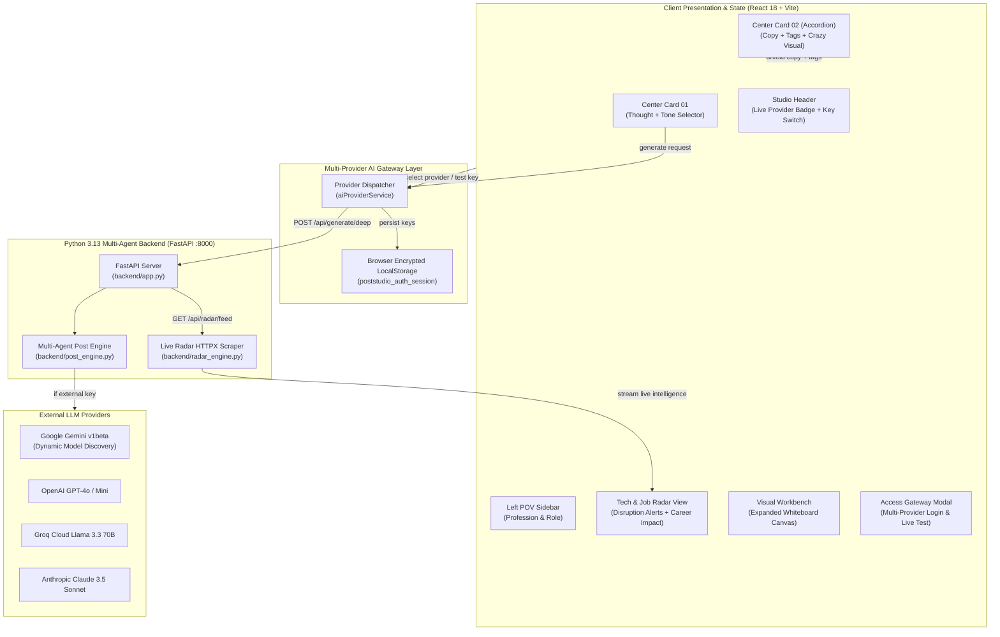

# Architecture Spine — PostStudio v2.2

## Design Paradigm

PostStudio employs the **Polyglot Hybrid Client-Reactive (PHCR)** paradigm. The system pairs a high-performance **Python 3.13 Multi-Agent Core** (FastAPI) with a responsive **React 18 / TypeScript Presentation Layer** (Vite), linked via resilient local REST endpoints and browser-native failovers:

1. **Presentation Layer (React 18 + TailwindCSS 4):**
   - Renders the sage-minimalist geometry (`#1F322C`, `#FAF8F5`).
   - Unfolding inline studio accordion, live provider switch badges, and distraction-free visual workbench.
2. **Multi-Provider AI Gateway Layer (`aiProviderService.ts`):**
   - Manages unified credential routing across **Google Gemini**, **OpenAI GPT-4o**, **Anthropic Claude**, **Groq Cloud**, and **Python Local**.
   - Auto-discovers supported models via official discovery endpoints (`/v1beta/models`, `/v1/models`).
3. **Python Multi-Agent Core Engine (`backend/`):**
   - `backend/post_engine.py`: Multi-agent semantic NLP parser, burstiness cadence auditor, and anti-AI phrase sanitizer.
   - `backend/radar_engine.py`: Live async HTTPX scraper ingesting developer dispatches and synthesizing career impact and leverage analysis.
   - `backend/app.py`: FastAPI application serving `/api/health`, `/api/generate/deep`, `/api/radar/feed`, and `/api/test-key`.
4. **Client-Side Synthesis & Fallback Layer (`antiAiEngine.ts`):**
   - Ensures zero user-facing error dialogs or broken states by seamlessly falling back to local semantic synthesis if external APIs or network calls encounter timeouts.
5. **Platform Adapters:**
   - Pure boundary adapters interfacing with `localStorage`, Web Speech API, and `navigator.clipboard`.

---

## Architectural Invariants & Rules

### AD-1 — Polyglot Split: Python Heavy Lifting & Client Agility
- **Rule:** Post generation heuristics, NLP syntactic decomposition, live tech feed scraping, and career leverage calculations belong to the **Python backend** (`backend/`). The frontend serves exclusively as a reactive, distraction-free creative workbench.
- **Benefit:** Empowers Python developers to showcase and extend real multi-agent NLP logic while preserving sub-16ms UI responsiveness.

### AD-2 — Resilient Multi-Provider Failover Chain
- **Rule:** All post generation calls execute through a prioritized 3-stage fallback pipeline:
  1. Primary: Python FastAPI backend (`/api/generate/deep`) with selected provider credentials.
  2. Secondary: Direct browser-side provider dispatch (`aiProviderService`).
  3. Tertiary: Local deterministic natural language synthesis (`antiAiEngine.ts`).
- **Invariant:** Generation must NEVER throw uncaught promise rejections or lock the user out.

### AD-3 — Dynamic Model Discovery (Anti-404 Invariant)
- **Rule:** Never hardcode specific transient LLM model strings (e.g. `gemini-1.5-pro-002`). The application queries provider catalog endpoints (`GET /v1beta/models?key=...`) to determine currently provisioned models and automatically routes traffic to the optimal available tier (`gemini-1.5-flash`, `gemini-2.0-flash`).

### AD-4 — High-Stakes Career Disruption Intelligence
- **Rule:** The Tech & Job Radar must never return generic news summaries or shallow bullet points. The `enrich_career_impact` pipeline in `backend/radar_engine.py` strictly maps technological advances to concrete developer leverage:
  - Automatable tasks vs. high-compensation skills (\$200k–\$320k senior bands).
  - Explicit action recommendations (Adopt, Deprecate, or Monitor).
  - Bold typography hierarchy with prominent pull quotes.

### AD-5 — Distraction-Free Visual Workbench
- **Rule:** The Visual Workbench whiteboard canvas must remain completely clean on mount, free from pre-rendered example blueprints, shape clutter, or mock templates. The user retains 100% agency to design custom diagrams, shapes, and architecture visuals from scratch.

### AD-6 — Zero-Server Credential Storage
- **Rule:** User API keys (Gemini, OpenAI, Anthropic, Groq) and personal identity settings reside strictly on the user's local device in browser `localStorage`. No credentials are ever relayed through third-party telemetry, trackers, or centralized proxy databases.
