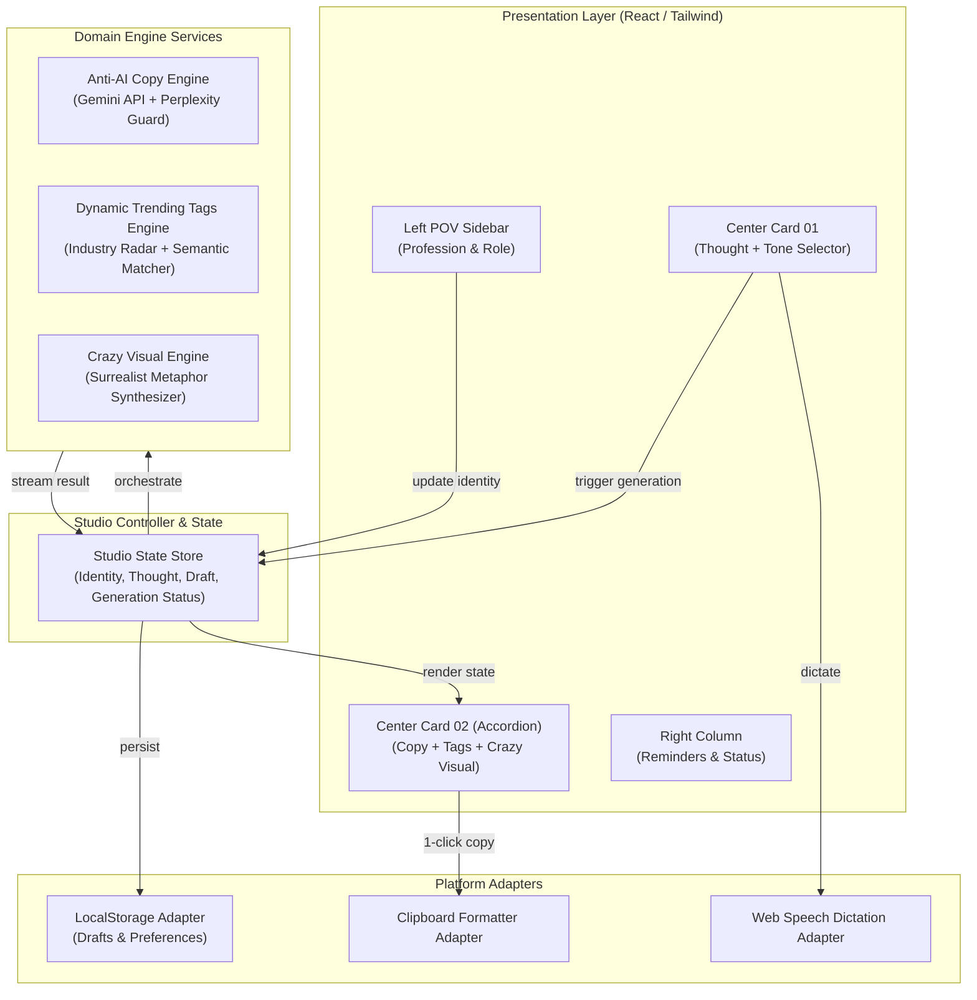

# Architecture Spine — PostStudio (LinkedIn Post Maker)

## Design Paradigm

PostStudio adopts the **Layered Client-Reactive (LCR)** paradigm. The system is split into four decoupled layers with unidirectional data flow:
1. **Presentation Layer (Views & Atoms):** Pure presentation components adhering to the screenshot's sage-minimalist geometry (`#1B3B2B`, `#F4F6F0`).
2. **Studio State & Orchestrator:** Centralized reactive state store managing user identity, thought draft, tone override, generation progress, and draft history.
3. **Domain Engine Services:** Stateless engines for Anti-AI text synthesis, two-tier trending tag calculation, and surrealist visual generation.
4. **Platform Adapters:** Pure boundary adapters interfacing with `localStorage`, Web Speech API (voice dictation), and `navigator.clipboard`.



---

## Invariants & Rules

### AD-1 — Layered Clean Client Architecture
- **Binds:** All presentation and logic modules.
- **Prevents:** Business logic and AI prompt assembly polluting UI component trees or causing inconsistent state transitions.
- **Rule:** UI components must never make raw API requests or mutate `localStorage` directly. All actions must dispatch through the `StudioController` service layer.

### AD-2 — Deterministic Anti-AI Lexical & Rhythm Filter
- **Binds:** `TextEngine`, prompt pipelines.
- **Prevents:** Typical LLM cliché post output (*"delve", "testament to", "game-changer", "let's dive into"*) that triggers AI detection algorithms and reader fatigue.
- **Rule:** 
  1. The engine enforces an explicit negative vocabulary blocklist.
  2. The prompt imposes a strict burstiness formula: alternating short punchy sentences (under 6 words) with reflective analytical sentences (15–20 words).
  3. Every post begins with an authentic observation, contrarian spark, or practical question—never a generic introductory clause.

### AD-3 — Two-Tier Dynamic Trending Tags Engine
- **Binds:** `TrendEngine`, UI hashtag pills.
- **Prevents:** Static, out-of-date, or irrelevant hashtags that fail to boost algorithmic reach on LinkedIn.
- **Rule:**
  1. **Tier 1 (Industry Radar):** Evaluates macro trending topic seeds matching the user's `Profession` and `Role`.
  2. **Tier 2 (Semantic Context Match):** Generates 5–8 high-velocity tags matching the generated post's specific subject.
  3. Each tag is annotated with a momentum tier (`🔥 Trending`, `📈 Rising`, `🎯 Core`).
  4. Clicking any tag pill toggles its insertion directly into the post buffer with single-space formatting.

### AD-4 — Surrealist "Crazy" Conceptual Visual Engine
- **Binds:** `ImageEngine`, Visual canvas.
- **Prevents:** Boring corporate stock photos, generic boardroom handshakes, or predictable clipart.
- **Rule:** Visual prompts must combine the user's core theme with surrealist editorial metaphors (e.g., *retro-futuristic 3D isometric apparatus, glowing fiber-optic bonsai trees, neon architectural landscapes*). Images are rendered with high visual contrast and exported via standard Data URI / Blob with an instant `📥 Download Image` trigger.

### AD-5 — Zero-Auth Offline-First Persistence
- **Binds:** `StorageAdapter`.
- **Prevents:** User bounce caused by forced signup walls or loss of daily settings between browser sessions.
- **Rule:** `Profession`, `Role`, user preferences, and the `Drafts` ledger must persist in browser `localStorage`. No login is required for day-to-day operation.

### AD-6 — Inline Accordion Unfolding UX Geometry
- **Binds:** `CardOutput`, layout container.
- **Prevents:** Layout jumping, modals obscuring context, or awkward side-panel displacement.
- **Rule:** The generated result must unfold smoothly directly underneath Card 01 using CSS spring transition/Framer Motion. The 3-column desktop layout (Left: 260px, Center: flexible 680–760px, Right: 300px) remains structurally anchored.

### AD-7 — Native Clean Clipboard Formatting
- **Binds:** `ClipboardAdapter`.
- **Prevents:** Messy double-encoded markdown symbols or flattened single-line walls of text when pasting into LinkedIn.
- **Rule:** The clipboard pipeline strips raw markdown artifacts while strictly preserving intentional double-newline paragraph spacing optimized for LinkedIn's mobile and desktop feeds.

---

## Consistency Conventions

| Concern | Convention |
|---|---|
| **Naming** | PascalCase for UI components (`StudioSidebar`, `ThoughtCard`, `UnfoldingResultCard`); camelCase for hooks and engines (`useStudioState`, `generatePostCopy`, `fetchTrendingTags`). |
| **Data & Envelopes** | Generated post shape: `{ id: string, copy: string, tags: TagItem[], imagePrompt: string, imageUrl: string, createdAt: number, tone: ToneMode }`. |
| **Error Handling** | Graceful degradation: if image generation fails, post copy and trending tags remain fully accessible with an inline retry banner. |
| **Styling & Theme** | Tailwind utility classes with custom semantic color variables (`bg-sage-50`, `bg-sage-900`, `border-sage-200`, `text-sage-950`). |

---

## Stack (Verified Stable & Current)

| Technology | Role | Selected Version / Standard |
|---|---|---|
| **React** | Core UI Library | 18.3+ |
| **Vite** | Build Tool & Fast Dev Server | 5.4+ |
| **TypeScript** | Type Safety | 5.4+ |
| **TailwindCSS** | Styling & Design System | 3.4+ |
| **Framer Motion** | Inline Accordion Animation | 11.0+ |
| **Lucide React** | Clean Minimalist Iconography | 0.450+ |
| **Google GenAI / Gemini**| LLM Text & Vision Engine | Gemini 2.5 / 3 Flash |

---

## Structural Seed

```text
linkedin-post-studio/
├── public/
│   └── favicon.svg
├── src/
│   ├── assets/               # Brand assets & placeholder visual seeds
│   ├── components/
│   │   ├── layout/
│   │   │   ├── StudioHeader.tsx
│   │   │   ├── LeftSidebar.tsx      # Profession & Role selector
│   │   │   └── RightSidebar.tsx     # Quote reminder & status
│   │   ├── studio/
│   │   │   ├── ThoughtInputCard.tsx # Card 01: What's on your mind?
│   │   │   ├── TonePillSelector.tsx # Quick tone toggle pills
│   │   │   ├── UnfoldingCard.tsx    # Card 02: Inline animated reveal
│   │   │   ├── TrendingTagsBar.tsx  # Interactive clickable trending pills
│   │   │   ├── PostCopyEditor.tsx   # Human copy preview + edit
│   │   │   └── CrazyVisualCard.tsx  # Surrealist AI image preview & download
│   │   └── ui/                      # Reusable UI primitives (Button, Dropdown, Toast)
│   ├── services/
│   │   ├── antiAiEngine.ts          # Prompt synthesis & anti-AI filter
│   │   ├── trendingTagsEngine.ts    # Two-tier real-time tag generator
│   │   ├── crazyVisualEngine.ts     # Surrealist prompt builder & image gen
│   │   └── storageAdapter.ts        # LocalStorage persistence manager
│   ├── hooks/
│   │   ├── useStudioState.ts        # Unified reactive studio state
│   │   └── useSpeechToText.ts       # Voice dictation hook
│   ├── types/
│   │   └── studio.ts                # TypeScript domain models
│   ├── App.tsx                      # Root 3-column studio layout
│   └── main.tsx                     # React DOM entrypoint
├── tailwind.config.js
└── package.json
```

---

## Capability → Architecture Map

| Capability / Requirement | Lives In | Governed By |
|---|---|---|
| Persistent Profession & Role | `components/layout/LeftSidebar.tsx` | AD-1, AD-5 |
| Minimal Thought Input & Voice Mic | `components/studio/ThoughtInputCard.tsx` | AD-1, AD-6 |
| Anti-AI Non-Detectable Copy | `services/antiAiEngine.ts` | AD-2 |
| Dynamic Real-Time Trending Tags | `services/trendingTagsEngine.ts` | AD-3 |
| "Crazy" Surrealist AI Visuals | `services/crazyVisualEngine.ts` | AD-4 |
| Inline Unfolding Accordion UX | `components/studio/UnfoldingCard.tsx` | AD-6 |
| 1-Click Clipboard & Drafts | `services/storageAdapter.ts` | AD-5, AD-7 |

---

## Deferred

1. **LinkedIn Direct OAuth & Auto-Publishing API:** Deferred until core generation & clipboard flow is verified by users. The UI shows `● NOT CONNECTED` as seen in the reference screenshot.
2. **Multi-account Cloud Sync:** Deferred to future milestone. LocalStorage fulfills 100% of single-user daily posting needs.

